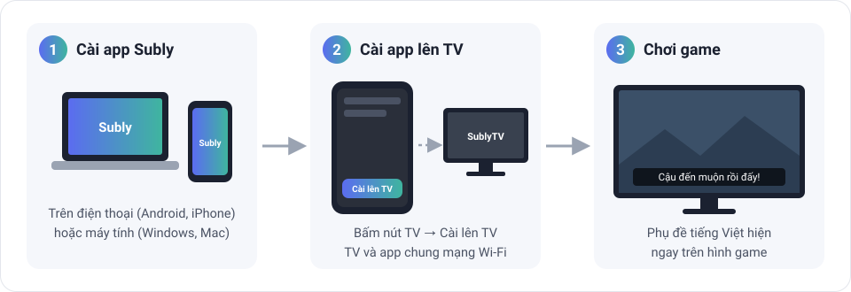
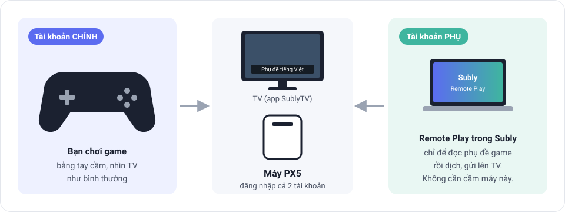

# Subly — dịch phụ đề game sang tiếng Việt

Chơi game trên máy **PX5**, phụ đề được dịch sang tiếng Việt và hiện **ngay trên TV**. App miễn phí.

<p align="center"><a href="https://www.facebook.com/profile.php?id=61596415627752"></a></p>

<h3 align="center">👉 <a href="https://www.facebook.com/profile.php?id=61596415627752">Page Facebook: facebook.com/profile.php?id=61596415627752</a></h3>

## Tính năng nổi bật

<table>
<tr>
<td width="50%" valign="top">

### 📚 Sẵn nhiều game đã việt hóa
Nhiều game có sẵn bản việt hóa của cộng đồng. Câu thoại có sẵn bản dịch thì hiện ngay, **không tốn token AI**.

</td>
<td width="50%" valign="top">

### 💰 Tiết kiệm token
Câu nào đã dịch rồi thì dùng lại, câu trùng lặp hay câu không cần dịch thì bỏ qua. Chỉ gửi AI những câu thật sự cần, dùng được cả **key Gemini miễn phí** ([cách lấy key](#3-lấy-key-gemini-miễn-phí-khuyến-nghị)).

</td>
</tr>
<tr>
<td width="50%" valign="top">

### 📖 Tóm tắt cốt truyện
Tự ghi lại cốt truyện, nhân vật, nhiệm vụ trong lúc chơi. Bỏ game lâu ngày quay lại, đọc tóm tắt là nhớ ngay đang tới đâu.

</td>
<td width="50%" valign="top">

### 📺 Hiện phụ đề trên mọi TV
Phụ đề tiếng Việt hiện ngay trên màn hình TV **Samsung, LG, Sony** và các TV **Android TV / Google TV** khác.

</td>
</tr>
</table>

<p align="center"></p>

## Tải về

Chọn bản cho thiết bị của bạn. Chỉ cần cài **một** trong các bản dưới.

| Thiết bị | Tải về | Lưu ý khi cài |
|---|---|---|
| 🤖 **Android** | [**Tải Subly-android-v0.1.18.apk**](https://github.com/subly-ps/subly-releases/releases/download/android-v0.1.18/Subly-android-v0.1.18.apk) | Mở file, cho phép **cài từ nguồn này** → Cài đặt |
| 📱 **iPhone / iPad** | [**Tải Subly-ios-v0.1.19-unsigned.ipa**](https://github.com/subly-ps/subly-releases/releases/download/ios-v0.1.19/Subly-ios-v0.1.19-unsigned.ipa) | Cài bằng **[Sideloadly](https://sideloadly.io)**, xem [bên dưới](#iphone--ipad) |
| 🍎 **Mac** | [**Tải Subly-macOS-v0.3.26.zip**](https://github.com/subly-ps/subly-releases/releases/download/mac-v0.3.26/Subly-macOS-v0.3.26.zip) | Phải chạy **1 lệnh Terminal**, xem [bên dưới](#mac) |
| 🪟 **Windows** | [**Tải Subly-Windows-v0.3.15.zip**](https://github.com/subly-ps/subly-releases/releases/download/win-v0.3.15/Subly-Windows-v0.3.15.zip) | Giải nén, mở `Subly.exe`. SmartScreen chặn thì bấm **More info → Run anyway** |

Máy tính (Mac, Windows) tự cập nhật bản mới trong app. Điện thoại: app báo có bản mới thì tải lại ở trang này.

### iPhone / iPad

File `.ipa` chưa ký, cần ký bằng Apple ID của bạn để cài:

1. Cài **[Sideloadly](https://sideloadly.io)** trên máy tính (Windows hoặc Mac), cắm iPhone vào máy tính.
2. Kéo file `.ipa` vào Sideloadly, nhập Apple ID → **Start**.
3. Trên iPhone: **Cài đặt → Cài đặt chung → VPN & Quản lý thiết bị** → tin cậy Apple ID vừa dùng.

> Apple ID miễn phí: app dùng được **7 ngày**, hết hạn thì mở Sideloadly ký lại.

### Mac

1. Giải nén, kéo **Subly.app** vào thư mục **Applications**.
2. Mở **Terminal**, dán lệnh này rồi bấm Enter (app chưa được Apple duyệt nên macOS chặn, báo *"đã bị hỏng"* hoặc *"không thể mở"*):

   ```sh
   xattr -dr com.apple.quarantine /Applications/Subly.app
   ```

3. Mở Subly, cho phép quyền **Ghi màn hình** khi được hỏi, rồi thoát hẳn app và mở lại.

## Cách dùng

### 1. Cài app lên TV

TV và điện thoại / máy tính phải **chung mạng Wi-Fi**. Trong Subly bấm **nút TV** ở góc trên → chọn loại TV (**Samsung**, **LG** hoặc **Android TV**) → **Cài lên TV**. Làm theo hướng dẫn hiện trong app (bật chế độ nhà phát triển trên TV, nhập IP của TV). Chỉ cần cài một lần.

### 2. Chuẩn bị 2 tài khoản PSN

<p align="center"></p>

- **Tài khoản chính:** tài khoản bạn vẫn dùng để chơi, cầm tay cầm chơi như bình thường.
- **Tài khoản phụ:** tạo thêm một tài khoản PSN (miễn phí), đăng nhập vào máy PX5. Tài khoản này chỉ dùng cho **Remote Play trong Subly** để app đọc phụ đề.

Trong Subly bấm **Thêm máy PX5** và đăng ký bằng **tài khoản phụ**: trên máy PX5 đăng nhập tài khoản phụ, vào **Settings → System → Remote Play → Link Device** lấy **mã PIN**, rồi nhập mã PIN và PSN Account ID của tài khoản phụ vào app. Chỉ làm một lần.

### 3. Lấy key Gemini miễn phí (khuyến nghị)

Key Gemini giúp dịch hay và đúng ngữ cảnh hơn, gói miễn phí đủ dùng khi chơi game.

1. Mở **[aistudio.google.com/apikey](https://aistudio.google.com/apikey)**, đăng nhập tài khoản Google.
2. Bấm **Create API key** (Tạo khoá API), rồi bấm **Copy** để sao chép key (dãy chữ bắt đầu bằng `AIza…`).
3. Trong Subly vào **⚙ Cài đặt → AI**, dán key vào ô **Gemini**.

> Không có key app vẫn dịch được bằng Google dịch, nhưng câu văn kém tự nhiên hơn.

### 4. Chơi

1. Chọn game trong danh sách game mẫu (hoặc nhập tên game).
2. Bấm **Kết nối & bắt đầu**.
3. Mở app **SublyTV** trên TV, chọn cổng HDMI của máy PX5 rồi chơi bằng tài khoản chính. Phụ đề tiếng Việt hiện trên TV.

## Hỗ trợ

Cần hỗ trợ cài đặt: nhắn tin **[page Facebook Subly](https://www.facebook.com/profile.php?id=61596415627752)** hoặc Telegram **[@subly_ps](https://t.me/subly_ps)**. Các bản cũ: xem mục [Releases](https://github.com/subly-ps/subly-releases/releases).
